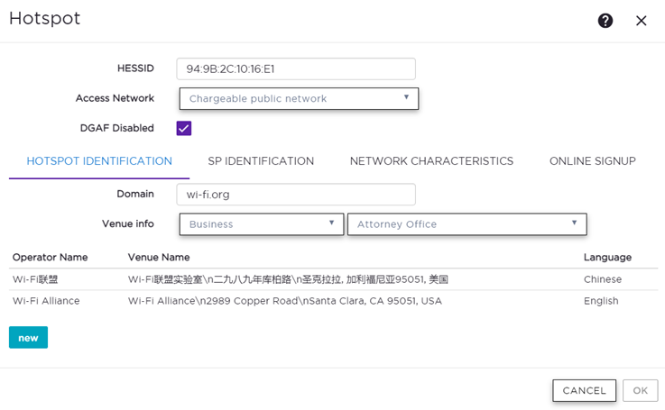
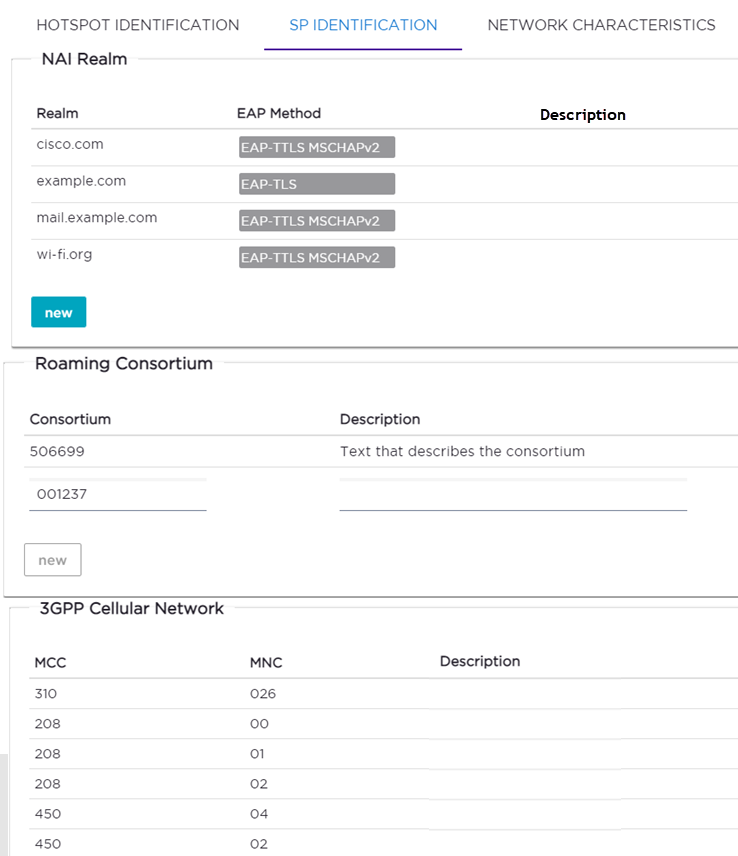
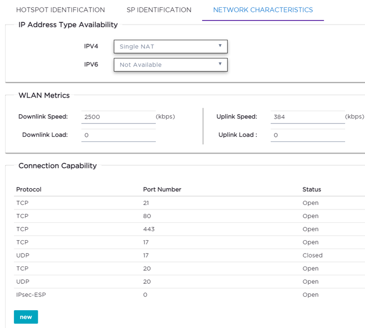

# LongFi Passpoint on ExtremeCloud IQ with RadSec

## Overview

This guide sets up a LongFi Passpoint (Hotspot 2.0) SSID on Extreme access points managed by an on-prem **ExtremeCloud IQ Controller (XIQ-C) v10.19.01**, with authentication carried to LongFi over RadSec (RADIUS over TLS, TCP 2083). Hotspot 2.0 is configured natively in the controller GUI; there is no supplemental CLI and no full configuration push.

## Before you start

Collect every value below before touching the controller.

| Item | Used in | Value |
| --- | --- | --- |
| Client certificate and private key (.p12/.pfx, or separate files) and its password | Step 1 | Issued by LongFi |
| LongFi CA certificate (PEM) | Step 1 | Issued by LongFi |
| Primary RadSec server | Step 3 | 136.107.123.32 Port: 2083 |
| Secondary RadSec server | Step 3 | 34.174.6.104 Port: 2083 |
| RadSec shared secret | Step 3 | `radsec` (RadSec default) unless LongFi specifies another |

**Firewall:** at a Centralized site the controller handles session management, so RadSec is expected to leave from the controller, not the APs. Allow TCP 2083 outbound from **both controller VMs** (HA pair) to both LongFi servers. Confirm the source in the controller's RADIUS diagnostics during the pilot.

## Step 1: Add the LongFi RadSec Trust Point

RadSec can't be selected on a RADIUS server until a Trust Point exists.

1. Go to **Administration** > **System** > **PKI Trust Points**.
2. Select **Add**.
3. Enter a **Trust Point Name**, such as `LongFi_RadSec`.
4. Choose the upload option that matches the files LongFi sent:
    - **Encrypted PKCS#12**: select the .p12/.pfx file and enter its password.
    - **Separate files**: select the certificate file and the private key file, and enter the key password.
5. Select the LongFi **CA certificate** (PEM) so the controller can verify LongFi's server certificate.
6. Select **Save**.

## Step 2: Create the WLAN with Hotspot enabled

1. Go to **Configure** > **Networks** > **WLANs** and select **Add**.
2. Set **Network Name** to `LongFi Passpoint` (internal name).
3. Set **SSID** to the name clients will see, such as `LongFi Passpoint` (up to 32 characters, case-sensitive).
4. Set **Status** to **Enabled**.
5. Set **Hotspot** to **Enabled**. A **Configure** button appears; leave it for Step 4.
6. Set **Auth Type** to **WPA2-Enterprise (802.1X/EAP)**.
7. Confirm **Client-Client Communication** is off and PMF is required.
8. Set **Default Auth Role** (for example **Enterprise User**) and **Default VLAN** to the venue's guest topology.
9. Don't save yet. The AAA policy comes next, from this same page.

## Step 3: Create the AAA policy with the LongFi RadSec servers

Create a **new** AAA policy. An existing policy can't be switched to NAI routing later.

1. On the WLAN page, in the **AAA Policy** field, select the **add** icon.
2. Set **Name** to `LongFi_AAA`.
3. Leave **NAI Routing** off. Turn it on only if LongFi asks for several realms routed to different servers (up to 4 realms per policy).
4. Set **Accounting Type** to **Start-Interim-Stop**.
5. Set **Accounting Interim Interval** to `300` seconds (default 60).
6. Set **RADIUS Authentication Servers Mode** to **Failover**.
7. Sset **Operator Name** to **LONGFISOLUTIONS:US**.
8. Under authentication servers, select **Add** and enter the primary server:
    - **Type**: **Secure (RADSEC)**
    - **Server Address**: `136.107.123.32`
    - **Port**: `2083`
    - **Trust Point**: `LongFi_RadSec`
    - **Shared Secret**: `radsec` unless LongFi gave another
    - Leave **Peer Discovery** off
9. Repeat step 8 for the secondary server `34.174.6.104`
10. Add the same two servers as **accounting** servers.
11. Save the AAA policy. It is now selected on the WLAN.

## Step 4: Configure the Hotspot

On the WLAN page, select **Configure** next to **Hotspot**. Fill in every required field on a tab before selecting **OK**.

### Main settings

1. **HESSID**: leave the default (the controller's Ethernet MAC). It must be unique per WLAN; if you set it by hand, use an AP BSSID.
2. **Access Network**: Chargeable public network.
3. **DGAF Disabled**: leave checked (default).

### Hotspot Identification tab

1. **Domain**: enter `longfisolutions.com`. Add sub-domains such as `freedomfi.com`.
2. **Venue Info**: pick the venue group, then the venue type. Choose the option that best matches your site.
3. Select **New** and enter **Operator Name** `LONGFISOLUTIONS:US`, the **Venue Name**, and **Language** English.

### SP Identification tab

1. Under **Realm**, select **New** and enter the following: 

**Realm:** longfisolutions.com | EAP Method: **EAP-TLS** with inner authentication **Certificate** if available

**Realm:** freedomfi.com | EAP Method: **EAP-TLS** with inner authentication **Certificate** if available

**Realm:** hellohelium.com | EAP Method: **EAP-TLS** with inner authentication **Certificate** if available

**Realm:** wifi.fi.google.com | EAP Method: **EAP-TLS** with inner authentication **Certificate** if available

2. Under **Roaming Consortium**, add the following: 

Consortium: F4F5E8F5F4

Description: Orion 

Consortium: 2A2F830000

Description: Uplink

3. For **3GPP Cellular Network** enter the MCC/MNC codes provided by Longfi during onboarding.  MCC/MNC pairs.

The following screenshot is just an example:

### Network Characteristics tab

1. **IP Address Type Availability**: IPv4 **Single NAT**, IPv6 **Not Available**.
2. **WLAN Metrics**: optional. Enter the venue's uplink and downlink speeds if necessary.
3. **Connection Capability**: optional. If used, list the ports that are open (up to 16) rather than leaving them Unknown.

### Online Signup tab

Leave unconfigured. LongFi profiles are provisioned on the device, so no OSU network is needed.

Select **OK**, then **Save** the WLAN. From here, Hotspot can't be turned off on this WLAN.

## Step 5: Assign the WLAN to the AP profiles

Each Device Group holds one AP model, so repeat this for every model that will carry the LongFi SSID. For the pilot, use a Device Group that contains only the pilot AP.

1. Go to **Configure** > **Sites** and select the site.
2. Open the **Device Groups** tab and select the device group.
3. Next to **Profile**, select the **edit** icon.
4. Open the **Networks** tab.
5. For `LongFi Passpoint`, select the **5 GHz** radios. We don't recommend leaving 2.4 GHz on. Leave **6 GHz** unselected; the controller rejects WPA2 networks there.
6. If the controller warns that the change affects a radio's **primary BSSID**, stop: that radio will reset and drop its clients. Pick a time when that's acceptable, or assign the SSID so it isn't the primary BSSID.
7. Select **Save**. The controller pushes the change to the APs in that group; they don't reboot.

## 

## Sources

ExtremeCloud IQ Controller v10.19.01 User Guide:

- [Hotspot](https://documentation.extremenetworks.com/ExtremeCloud%20IQ%20Controller%20v10.19.01%20User%20Guide/content/documents/ExtremeCloud_IQ_Controller/XIQC_User_Guide_OLH/topics/hotspot.shtml)
- [Configure Hotspot](https://documentation.extremenetworks.com/ExtremeCloud%20IQ%20Controller%20v10.19.01%20User%20Guide/content/documents/ExtremeCloud_IQ_Controller/XIQC_User_Guide_OLH/topics/configure_hotspot.shtml)
- [Hotspot Identification](https://documentation.extremenetworks.com/ExtremeCloud%20IQ%20Controller%20v10.19.01%20User%20Guide/content/documents/ExtremeCloud_IQ_Controller/XIQC_User_Guide_OLH/topics/hotspot_identification.shtml)
- [SP Identification](https://documentation.extremenetworks.com/ExtremeCloud%20IQ%20Controller%20v10.19.01%20User%20Guide/content/documents/ExtremeCloud_IQ_Controller/XIQC_User_Guide_OLH/topics/sp_identification_task.shtml)
- [Network Characteristics](https://documentation.extremenetworks.com/ExtremeCloud%20IQ%20Controller%20v10.19.01%20User%20Guide/content/documents/ExtremeCloud_IQ_Controller/XIQC_User_Guide_OLH/topics/network_characteristics_task.shtml)
- [WLAN Service Settings](https://documentation.extremenetworks.com/ExtremeCloud%20IQ%20Controller%20v10.19.01%20User%20Guide/content/documents/ExtremeCloud_IQ_Controller/XIQC_User_Guide_OLH/topics/wlan_service_settings.shtml)
- [Add a Trust Point](https://documentation.extremenetworks.com/ExtremeCloud%20IQ%20Controller%20v10.19.01%20User%20Guide/content/documents/ExtremeCloud_IQ_Controller/XIQC_User_Guide_OLH/topics/add_a_trust_point.shtml)
- [RADIUS Settings](https://documentation.extremenetworks.com/ExtremeCloud%20IQ%20Controller%20v10.19.01%20User%20Guide/content/documents/ExtremeCloud_IQ_Controller/_reused/radius_settings.shtml)
- [AAA Policy Settings](https://documentation.extremenetworks.com/ExtremeCloud%20IQ%20Controller%20v10.19.01%20User%20Guide/content/documents/ExtremeCloud_IQ_Controller/XIQC_User_Guide_OLH/topics/aaa_policy_settings.shtml)
- [NAI Routing](https://documentation.extremenetworks.com/ExtremeCloud%20IQ%20Controller%20v10.19.01%20User%20Guide/content/documents/ExtremeCloud_IQ_Controller/_reused/nai_routing.shtml)
- [Add or Edit a Configuration Profile](https://documentation.extremenetworks.com/ExtremeCloud%20IQ%20Controller%20v10.19.01%20User%20Guide/content/documents/ExtremeCloud_IQ_Controller/XIQC_User_Guide_OLH/topics/add_or_edit_a_configuration_profile.shtml)
