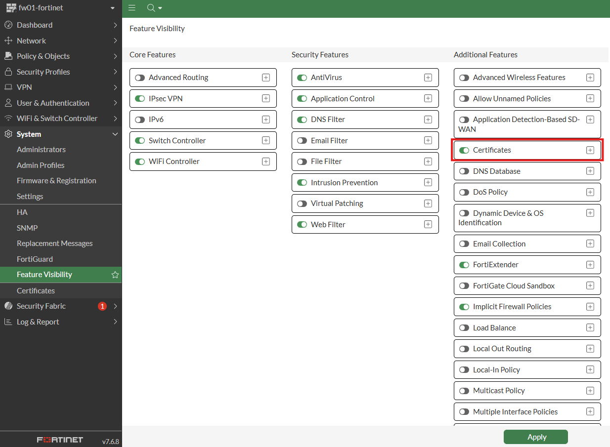
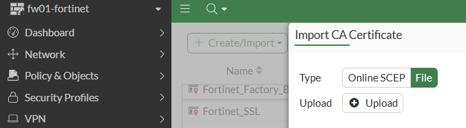
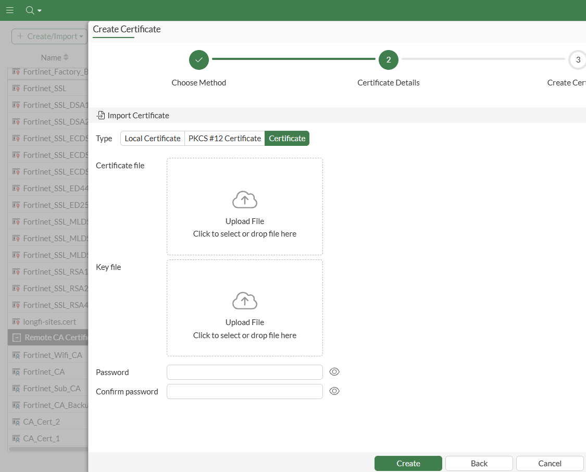
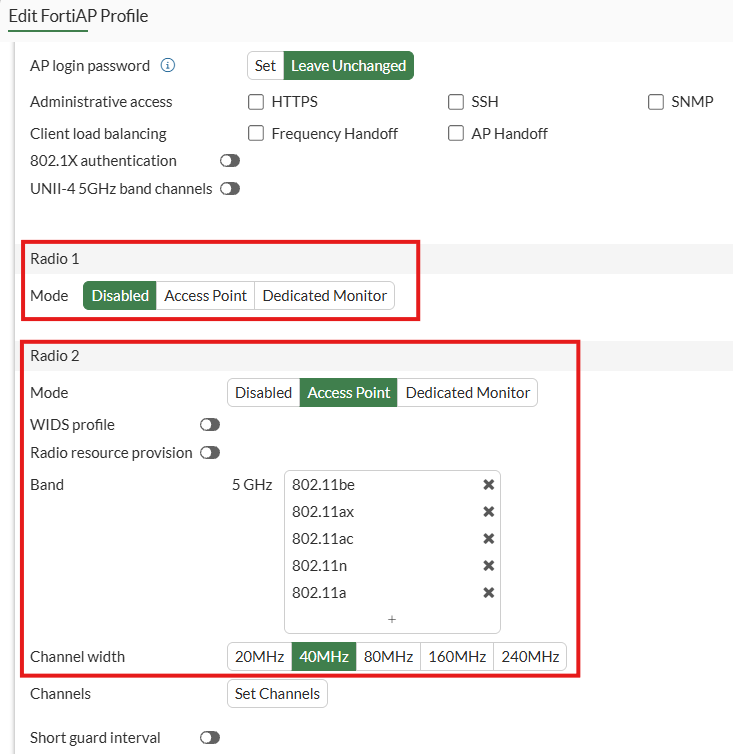

# LongFi Passpoint + RadSec on FortiGate & FortiAP — Configuration Guide (DRAFT)

> **Status:** Internal draft. Staged in `wlan-configs`. Once lab-validated it will be
> published to longfi-solutions.github.io → docs.longfisolutions.com.

## Overview

This guide configures a FortiGate (firewall + wireless controller) and its managed
FortiAPs to broadcast a LongFi Passpoint (Hotspot 2.0) SSID. Subscriber devices
authenticate automatically with EAP-TLS; the FortiGate carries RADIUS to LongFi
over **RadSec** (RADIUS over TLS, TCP 2083) to `connect.longfisolutions.com`.

**No radsecproxy is required.** Older Fortinet deployments (FortiOS 7.0–7.4)
used a local radsecproxy because FortiOS could only send plain UDP RADIUS for
Wi-Fi. FortiOS 7.6.0 added native RadSec for WPA2/WPA3-Enterprise SSIDs.

## Requirements

| Item | Requirement |
| --- | --- |
| FortiOS | **7.6.0 or later** (7.6.4+ recommended). 7.4.x supports RadSec for firewall/admin auth only, not Wi-Fi. |
| FortiAP firmware | Supported by your FortiOS release (see Fortinet compatibility matrix) |
| Outbound access | FortiGate → `connect.longfisolutions.com` TCP **2083** |
| DNS | FortiGate must resolve `connect.longfisolutions.com` |
| From LongFi | LongFi CA certificate chain, a site client certificate + private key, and a NAS-ID |

## What is configured where

| Task | GUI | CLI |
| --- | :---: | :---: |
| Firmware upgrade | ✅ |  |
| Import CA and client certificates | ✅ |  |
| RADIUS server (RadSec / TLS options, client cert) |  | ✅ |
| Hotspot 2.0 / ANQP profiles |  | ✅ |
| SSID (VAP) + attach Hotspot 2.0 profile |  | ✅ |
| SSID addressing, DHCP, firewall policy | ✅ | ✅ |
| Assign SSID to FortiAP profile | ✅ | ✅ |

## Step 1 — Upgrade FortiOS

**System → Firmware & Registration.** Upgrade to FortiOS 7.6.x following Fortinet's
upgrade path tool, then upgrade FortiAPs (**WiFi & Switch Controller → Managed FortiAPs**).

## Step 2 — Import certificates (GUI)

1. Check if the **Certificate** option is available in the left menu by clicking on **System**, then **Certificates.** 

If **Certificates** is missing from the menu, enable it under **System → Feature Visibility → Certificates**.



**Importing the Certificates**

1. **System → Certificates → Create/Import → CA Certificate → File** — Click on the Upload button and import the LongFi Root CA (and Intermediate CA, if provided). FortiOS names it `CA_Cert_N`.



1. **System → Certificates → Create/Import → Certificate → Import Certificate**  —
   choose **PKCS #12** or **Certificate + key**, upload the site certificate LongFi provided:



## Step 3 — Configure the RadSec server (CLI)

```plain
config user radius
    edit "LongFi-RadSec"
        set server "connect.longfisolutions.com"
        set secret radsec
        set nas-id-type custom
        set nas-id "<NAS_ID>"
        set acct-interim-interval 300
        set radius-port 2083
        set transport-protocol tls
        set tls-min-proto-version TLSv1-2
        set ca-cert "<CA_CERT_NAME>"
        set client-cert "<SITE_ID>"
        config accounting-server
            edit 1
                set status enable
                set server "connect.longfisolutions.com"
                set secret radsec
            next
        end
    next
end
```

Test reachability: `execute telnet connect.longfisolutions.com 2083`

## Step 4 — Hotspot 2.0 profiles (CLI)

```plain
#### 2. NAI realms ####
config wireless-controller hotspot20 anqp-nai-realm
    edit "LongFi-NAI"
        config nai-list
            edit "longfi"
                set nai-realm "longfisolutions.com"
                config eap-method
                    edit 1
                        set method eap-tls
                        config auth-param
                            edit 1
                                set id credential
                                set val cred-certificate
                            next
                        end
                    next
                end
            next
            edit "freedomfi"
                set nai-realm "freedomfi.com"
                config eap-method
                    edit 1
                        set method eap-tls
                        config auth-param
                            edit 1
                                set id credential
                                set val cred-certificate
                            next
                        end
                    next
                end
            next
            edit "helium"
                set nai-realm "hellohelium.com"
                config eap-method
                    edit 1
                        set method eap-tls
                        config auth-param
                            edit 1
                                set id credential
                                set val cred-certificate
                            next
                        end
                    next
                end
            end


#### 3. AT&T 3GPP cellular (PLMN) list ####
config wireless-controller hotspot20 anqp-3gpp-cellular
    edit "ATT-PLMN"
        config mcc-mnc-list
            edit 1
                set mcc "310"
                set mnc "410"
            next
            edit 2
                set mcc "310"
                set mnc "280"
            next
            edit 3
                set mcc "310"
                set mnc "150"
            next
            edit 4
                set mcc "313"
                set mnc "100"
            next
        end
    next
end


#### 4. Roaming consortium ####
config wireless-controller hotspot20 anqp-roaming-consortium
    edit "LongFi-RCOI"
        config oi-list
            edit 1
                set oi "F4F5E8F5F4"
                set comment "Orion"
            next
            edit 2
                set oi "2A2F830000"
                set comment "Uplink"
            next
        end
    next
end

#### 5. IP address type ####
config wireless-controller hotspot20 anqp-ip-address-type
    edit "LongFi-IP"
        set ipv4-address-type single-NATed-private
        set ipv6-address-type not-available
    next
end

#### 6. Hotspot profile ####
config wireless-controller hotspot20 hs-profile
    edit "LongFi-HS20"
        set access-network-type chargeable-public-network
        set access-network-internet enable
        set domain-name "longfisolutions.com,freedomfi.com"
        set nai-realm "LongFi-NAI"
        set 3gpp-plmn "ATT-PLMN"
        set roaming-consortium "LongFi-RCOI"
        set ip-addr-type "LongFi-IP"
        set venue-group <set per site>
        set venue-type <set per site>
    next
end
```

## Step 5 — Create the Passpoint SSID

## 

```plain

config wireless-controller vap
    edit "LongFi-PP"
        set ssid "<SSID>"
        set security wpa2-only-enterprise
        set pmf optional
        set auth radius
        set radius-server "LongFi-RadSec"
        set hotspot20-profile "LongFi-HS20"
    next
end
```

Tunnel mode is the default: client traffic returns to the FortiGate and is NATed.
For local-bridge mode, see the comments in the template.

## Step 6 — Broadcast on the FortiAPs

In the GUI, click on  **WiFi & Switch Controller → FortiAP Profiles → <profile>**,
Radio 1 is the 2.4 GHz band, and Radio 2 is the 5 GHz band. We recommend disabling 2.4Ghz to avoid interference.



**6 GHz (FortiAP 431G and other 6E models):** WPA2-Enterprise SSIDs don't broadcast
on 6 GHz. To offer Passpoint on 6 GHz, create a second VAP with
`set security wpa3-only-enterprise` and `set pmf enable` using the same
`hotspot20-profile` and `radius-server`, and assign it to radio-3.

## Step 7 — Verify

```plain
diagnose debug application fnbamd -1
diagnose debug enable
#  connect a Passpoint device; look for "proto: TCP over TLS" and Access-Accept
diagnose debug disable
diagnose debug reset

diagnose wireless-controller wlac -d sta online
```

## Troubleshooting

| Symptom | Check |
| --- | --- |
| TLS handshake fails | Wrong/missing CA cert; client cert not issued by LongFi CA; system clock wrong (check NTP) |
| "server identity check" errors | Server name must match the cert CN/SAN. Use the FQDN, not an IP. As a last resort `set server-identity-check disable` |
| No TCP connection on 2083 | Upstream firewall/ISP blocking outbound 2083; DNS resolution |
| Device doesn't auto-join | Verify the device has a LongFi Passpoint profile; confirm RCOIs/realms in the hs-profile; confirm SSID is broadcasting (`diagnose wireless-controller wlac -c vap`) |
| Wi-Fi Calling fails | Ensure UDP 500/4500 and ESP aren't blocked on the SSID policy |

## References

- [FortiOS 7.6.0 — Support RADSEC on WPA2/WPA3-Enterprise SSID](https://docs.fortinet.com/document/fortigate/7.6.0/new-features/300051/support-radsec-on-wpa2-wpa3-enterprise-ssid)
- [FortiOS 7.6.4 — Configuring a RADSEC client](https://docs.fortinet.com/document/fortigate/7.6.4/administration-guide/729374/configuring-a-radsec-client)
- [FortiAP 7.6.4 — Hotspot 2.0 ANQP configuration](https://docs.fortinet.com/document/fortiap/7.6.4/fortiwifi-and-fortiap-configuration-guide/657393/hotspot-2-0-anqp-configuration)

https://www.fortinet.com/content/dam/fortinet/assets/data-sheets/Fortinet_Product_Matrix.pdf

https://www.fortinet.com/content/dam/fortinet/assets/data-sheets/Fortinet_Wireless_Product_Matrix.pdf

https://www.fortinet.com/content/dam/fortinet/assets/data-sheets/pdf/fortiswitch-secure-access-series.pdf#page=9

https://www.fortinet.com/content/dam/fortinet/assets/data-sheets/pdf/fortiap-series.pdf#page=4
